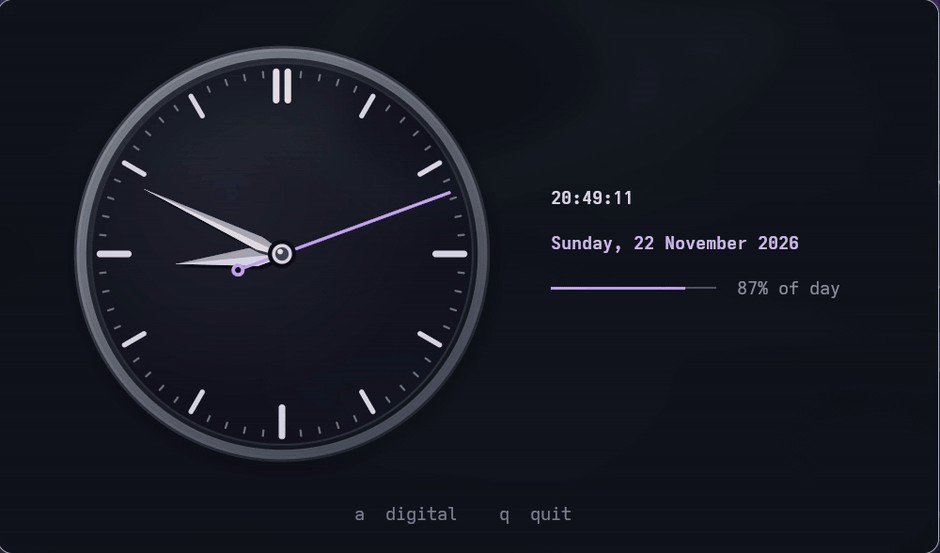

# Golarm

A terminal clock with a sweeping analog dial, countdown timer, stopwatch
with laps, and alarms. All in a single Go binary.

```sh
golarm --analog
```



Recorded in Kitty on Hyprland using the Catppuccin theme.

## Install

Download a Linux archive from [GitHub Releases](https://github.com/Hesamation/golarm/releases)
and put the extracted `golarm` binary on your `PATH`. Desktop notifications
use `notify-send`.

With Go 1.26.1 or later, you can also install from source.

```sh
go install github.com/Hesamation/golarm@latest
```

From a local checkout, use `make install`. Arch users can build the package
from `packaging/`.

## Features

- **Clock** — analog or figlet, 24h or 12h, day progress, Gregorian or Shamsi
  dates with weekday names
- **Timer** — pause/resume, restart, ±1 minute adjustment, blinking alarm
  with a critical desktop notification on fire
- **Chrono** — stopwatch with laps (splits + totals) and reset
- **Alarm** — fire at a wall-clock time, rolls over to the next day
- **Headless mode** — `golarm timer 5m -q` blocks, notifies, exits 0: chain
  it in scripts
- **Persian digits** (`--fa`), **themes** (`--theme`), Persian weekday names

The Shamsi conversion uses the Borkowski algorithm as implemented by
[jalaali-js](https://github.com/jalaali/jalaali-js), validated against the
official Iranian calendar and pinned by a golden test covering every day of
1970–2100.

<details>
<summary>Digital clock, timer, and stopwatch demos</summary>


</details>

## Usage

```sh
golarm [--theme T] [clock] [-12] [--fa] [--analog] [--calendar MODE]
golarm --analog=ansi                     # force the color-cell dial
golarm timer 5m30s [-l LABEL] [-q]         # countdown timer
golarm chrono                              # stopwatch with laps
golarm alarm 7:30 [-l LABEL]               # wall-clock alarm
golarm -v | -h
```

Durations: `90` (seconds) | `90s` | `5m` | `1h30m` | `10:00` (mm:ss) |
`1:30:00`. Alarm times: `07:30` (24h) or `7:30pm`.

### Terminal support

Press `a` to switch faces. Golarm checks for Kitty graphics and usable
terminal pixel dimensions to show the full-resolution dial. Other color
terminals draw a dial optimized for half blocks. The color-cell dial also
runs in tmux and screen. Golarm switches to digital time when color is
disabled or the window gets too small.

| Tested terminal | Analog renderer |
| --------------- | --------------- |
| Kitty 0.51.0 | Pixel graphics |
| Ghostty 1.4.0 | Pixel graphics |
| foot 1.28.0 | Color cells |
| tmux 3.8 inside Kitty | Color cells |


The dial follows the active theme and changes the seconds-hand color
throughout the day. In narrow windows, the date and day progress move
below the dial.

### Calendar

The clock shows the Gregorian date by default. Use `golarm --calendar shamsi`
for Shamsi (Solar Hijri) or `golarm --calendar both` for both dates. Set
`GOLARM_CALENDAR` to pick your shell's default. `--fa` selects Persian digits
independently of the calendar.

### Themes

`default` (slate), `catppuccin`, `gruvbox`, `tokyo-night` — via `--theme`
or `GOLARM_THEME`.

### Environment

| Variable       | Effect                    |
| -------------- | ------------------------- |
| `GOLARM_12H=1` | default to 12-hour clock  |
| `GOLARM_FA=1`  | default to Persian digits |
| `GOLARM_CALENDAR` | default to `gregorian`, `shamsi`, or `both` |
| `GOLARM_THEME` | default theme name        |

### Controls

| Key                   | Action                                         |
| --------------------- | ---------------------------------------------- |
| `Space`               | pause/resume · dismiss a fired alarm           |
| `r`                   | restart timer · re-arm alarm · reset stopwatch |
| `l`                   | record a lap (chrono)                          |
| `a`                   | switch between analog and digital (clock)      |
| `+` / `-` (or arrows) | adjust timer by one minute                     |
| `q` / `Esc`           | quit                                           |

## Scripting

```sh
golarm timer 5m -q && notify-send "Pasta done"
golarm timer 90 -q && make deploy
```

`-q` runs without the TUI, sends the notification, and exits 0 on
completion (or non-zero if interrupted).

## Development

```sh
make test   # go test ./...
make vet    # go vet ./...
make fmt    # gofmt
make build  # versioned, stripped binary
```

The digital clock, timer, and stopwatch can also be recorded with
[VHS](https://github.com/charmbracelet/vhs) and the `.tape` files in the repo.
The TUI uses [Bubble Tea](https://github.com/charmbracelet/bubbletea).

## License

[MIT](LICENSE)
