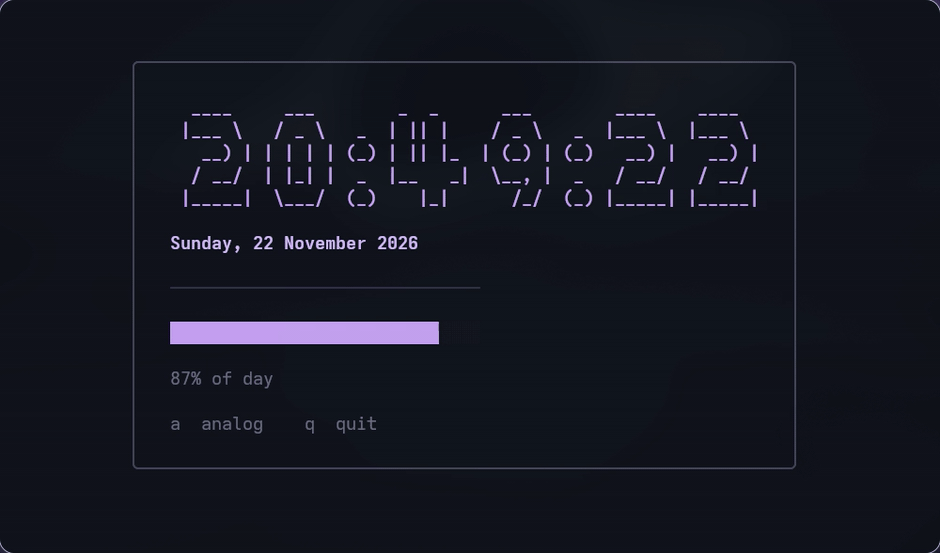
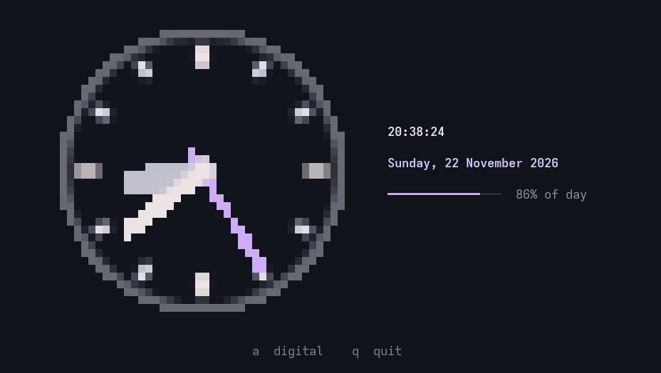

# Golarm

A sweeping analog clock for your terminal. Pick one of three dials and leave
it open in a split pane with Gregorian or Solar Hijri dates. Golarm also includes
a countdown timer, a lap stopwatch, and wall-clock alarms in a single Go binary.

```sh
golarm --theme catppuccin --analog --calendar both
```


Recorded in Kitty with the Catppuccin theme.

## Install

Download the Linux `amd64` or `arm64` archive from [GitHub Releases](https://github.com/Hesamation/golarm/releases)
and put the extracted `golarm` binary on your `PATH`. Desktop alerts use
`notify-send` and a desktop notification daemon.

With Go 1.26.1 or later, you can also install from source.

```sh
go install github.com/Hesamation/golarm@latest
```

Use `make install` to run the code from this checkout. The dial presets shown
here require a build newer than `v0.1.0`. Arch users can find the package recipe
in `packaging/`.

## Features

- **Clock** — analog or figlet, 24h or 12h, day progress, Gregorian or Shamsi
  dates with weekday names
- **Timer** — pause/resume, restart, ±1 minute adjustment, and a blinking
  alert. Switches to a compact countdown in narrow panes.
- **Chrono** — stopwatch with laps (splits + totals) and reset
- **Alarm** — schedule the next occurrence of a local time. Keep the terminal
  session running for the alarm to fire.
- **Headless mode** — `golarm timer 5m -q` waits and exits 0 when the countdown
  completes, so you can chain it in scripts.
- **Persian digits** (`--fa`), **themes** (`--theme`), Persian weekday names

The Shamsi conversion uses the Borkowski algorithm as implemented by
[jalaali-js](https://github.com/jalaali/jalaali-js), validated against the
official Iranian calendar and pinned by a golden test covering every day of
1970–2100.

<details>
<summary>Digital clock, timer, and stopwatch demos</summary>




</details>

## Usage

```sh
golarm [--theme T] [clock] [-12] [--fa] [--analog] [--calendar MODE]
golarm clock --dial sector --accent '#cdb1ff'
golarm clock --dial minimal --dial-only
golarm --analog=ansi                     # force the color-cell dial
golarm timer 5m30s [-l LABEL] [-q]         # countdown timer
golarm chrono                              # stopwatch with laps
golarm alarm 7:30 [-l LABEL]               # wall-clock alarm
golarm -v | -h
```

Durations: `90` (seconds) | `90s` | `5m` | `1h30m` | `10:00` (mm:ss) |
`1:30:00`. Alarm times: `07:30` (24h) or `7:30pm`.

### Terminal support

Press `a` to switch faces. Golarm checks for Kitty graphics and usable
terminal pixel dimensions to show the full-resolution dial. Other color
terminals draw a dial optimized for half blocks. The color-cell dial also
runs in tmux and screen. Golarm switches to digital time when color is
disabled or the window gets too small.

| Tested terminal | Analog renderer |
| --------------- | --------------- |
| Kitty 0.51.0 | Pixel graphics |
| Ghostty 1.4.0 | Pixel graphics |
| foot 1.28.0 | Color cells |
| tmux 3.8 inside Kitty | Color cells |



### Analog dials

Press `f` to cycle **Classic**, **Sector**, and **Minimal**. Use
`--dial classic|sector|minimal` to open directly on a design. All three
are available in both renderers. Sector uses bolder marks in color-cell
mode and shows its numerals when the pane is large enough.

Press `d` or launch with `--dial-only` to center the dial and hide the
readout and key hints. If the dial cannot fit, this view shows compact
digital time. Press `a` to switch to the regular digital clock.

The seconds hand and day meter follow the active theme. Set
`--accent '#cdb1ff'` to choose a fixed RGB accent for the clock. In narrow
windows, the date and day progress move below the dial.

### Calendar

The clock shows the Gregorian date by default. Use `golarm --calendar shamsi`
for Shamsi (Solar Hijri) or `golarm --calendar both` for both dates. Set
`GOLARM_CALENDAR` to pick your shell's default. `--fa` selects Persian digits
in the readout independently of the calendar. In Kitty, thin spaces keep the
digits in order. Very narrow panes use ASCII time when the spaced digits cannot
fit.

### Themes

`default` (slate), `catppuccin`, `gruvbox`, `tokyo-night` — via `--theme`
or `GOLARM_THEME`.

### Environment

| Variable       | Effect                    |
| -------------- | ------------------------- |
| `GOLARM_12H=1` | default to 12-hour clock  |
| `GOLARM_FA=1`  | default to Persian digits |
| `GOLARM_CALENDAR` | default to `gregorian`, `shamsi`, or `both` |
| `GOLARM_THEME` | default theme name        |

### Controls

| Key                   | Action                                         |
| --------------------- | ---------------------------------------------- |
| `Space`               | pause/resume timer or stopwatch · dismiss a fired alert |
| `r`                   | restart timer · re-arm alarm · reset stopwatch |
| `l`                   | record a lap (chrono)                          |
| `a`                   | switch between analog and digital (clock)      |
| `f`                   | cycle analog dials                              |
| `d`                   | toggle the dial-only view                       |
| `+` / `-` (or arrows) | adjust countdown or alarm time by one minute   |
| `q` / `Esc`           | quit                                           |

An alarm can be moved to a future time with `+` or `-`. Press `r` to re-arm it
for the next occurrence of the displayed time.

## Scripting

```sh
golarm timer 5m -q --label "Pasta"
golarm timer 90 -q && make test
```

`-q` runs without the TUI and exits 0 when the countdown completes. It attempts
a desktop notification on completion. Notification delivery is best effort.
Interrupting the countdown exits nonzero.

## Development

```sh
make test   # go test ./...
make vet    # go vet ./...
make fmt    # gofmt
make build  # versioned, stripped binary
```

The digital clock, timer, and stopwatch can also be recorded with
[VHS](https://github.com/charmbracelet/vhs) and the `.tape` files in the repo.
The TUI uses [Bubble Tea](https://github.com/charmbracelet/bubbletea).

## License

[MIT](LICENSE)
