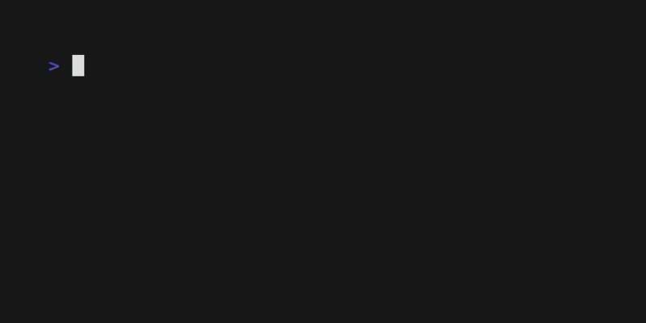

# golarm
A simple terminal clock, timer & stopwatch written in Go, using [Bubbletea](https://github.com/charmbracelet/bubbletea).

## Demos

### Clock


### Timer


### Stopwatch (Chrono)


## Installation
```bash
go install github.com/user/golarm@latest
```

## Usage
```bash
golarm              # 24h clock
golarm -12          # 12h clock
golarm timer 5m30s  # countdown timer
golarm chrono       # stopwatch
```

### Controls
* `Space` - Pause / Resume
* `q` / `Esc` - Quit
