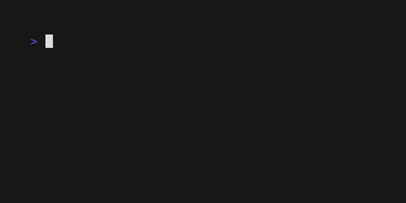

# golarm

A terminal clock, timer, stopwatch and alarm — a single Go binary with a
figlet clock face, Shamsi (Solar Hijri) + Gregorian dates, desktop
notifications, and themes, built with
[Bubbletea](https://github.com/charmbracelet/bubbletea).

## Demos

*(GIFs recorded on an earlier release)*

### Clock


### Timer


### Stopwatch (Chrono)


## Features

- **Clock** — 24h or 12h, day-progress bar, Shamsi (Jalaali) and Gregorian
  date lines with weekday names
- **Timer** — pause/resume, restart, ±1 minute adjustment, blinking alarm
  with a critical desktop notification on fire
- **Chrono** — stopwatch with laps (splits + totals) and reset
- **Alarm** — fire at a wall-clock time, rolls over to the next day
- **Headless mode** — `golarm timer 5m -q` blocks, notifies, exits 0: chain
  it in scripts
- **Persian digits** (`--fa`), **themes** (`--theme`), Persian weekday names

The Shamsi conversion uses the Borkowski algorithm as implemented by
[jalaali-js](https://github.com/jalaali/jalaali-js), validated against the
official Iranian calendar and pinned by a golden test covering every day of
1970–2100.

## Installation

```sh
go install github.com/Hesamation/golarm@latest
# from source:
make install
# Arch: see packaging/
```

## Usage

```sh
golarm [clock] [-12] [--fa] [--theme T]    # clock (default)
golarm timer 5m30s [-l LABEL] [-q]         # countdown timer
golarm chrono                              # stopwatch with laps
golarm alarm 7:30 [-l LABEL]               # wall-clock alarm
golarm -v | -h
```

Durations: `90` (seconds) | `90s` | `5m` | `1h30m` | `10:00` (mm:ss) |
`1:30:00`. Alarm times: `07:30` (24h) or `7:30pm`.

### Themes

`default` (slate), `catppuccin`, `gruvbox`, `tokyo-night` — via `--theme`
or `GOLARM_THEME`.

### Environment

| Variable       | Effect                    |
| -------------- | ------------------------- |
| `GOLARM_12H=1` | default to 12-hour clock  |
| `GOLARM_FA=1`  | default to Persian digits |
| `GOLARM_THEME` | default theme name        |

### Controls

| Key                   | Action                                         |
| --------------------- | ---------------------------------------------- |
| `Space`               | pause/resume · dismiss a fired alarm           |
| `r`                   | restart timer · re-arm alarm · reset stopwatch |
| `l`                   | record a lap (chrono)                          |
| `+` / `-` (or arrows) | adjust timer by one minute                     |
| `q` / `Esc`           | quit                                           |

## Scripting

```sh
golarm timer 5m -q && notify-send "Pasta done"
golarm timer 90 -q && make deploy
```

`-q` runs without the TUI, sends the notification, and exits 0 on
completion (or non-zero if interrupted).

## Development

```sh
make test   # go test ./...
make vet    # go vet ./...
make fmt    # gofmt
make build  # versioned, stripped binary
```

Demos are recorded with [vhs](https://github.com/charmbracelet/vhs):
`vhs clock.tape` (etc.). Packaging: `packaging/` (AUR PKGBUILD),
`completions/` (bash, zsh, fish), `docs/golarm.1` (man page).

## License

[MIT](LICENSE)
